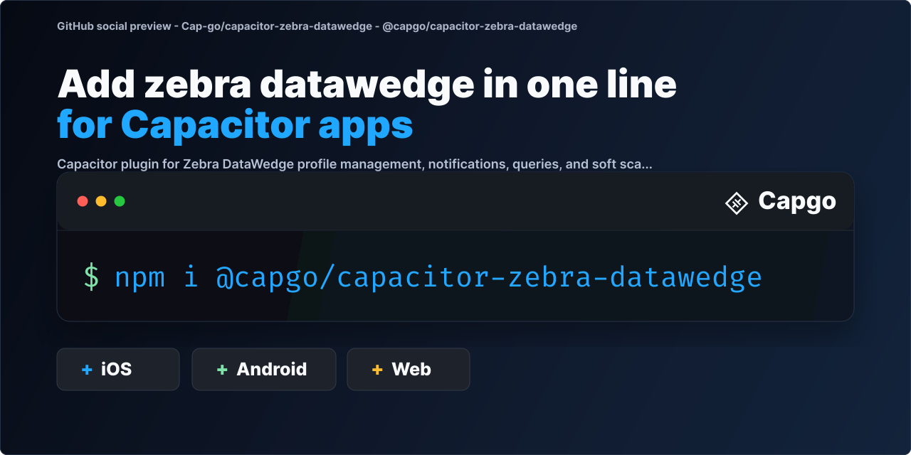

# @capgo/capacitor-zebra-datawedge

Scan barcodes and RFID tags on Zebra Android devices from your Capacitor app with DataWedge: manage profiles, trigger scans and receive results. An open alternative to Ionic's enterprise Zebra scanner.

<a href="https://capgo.app/?ref=plugin_zebra_datawedge">
  
</a>

<div align="center">
  <p>
    <b>Capgo</b>: push fixes to your Capacitor users in minutes, build signed iOS and Android apps without a Mac, and
    roll back in one click.
  </p>
  <h2>
    <a href="https://capgo.app/register/?ref=plugin_zebra_datawedge">➡️ Get started for free</a>
  </h2>
  <p>14-day unlimited free trial. No credit card required</p>
</div>

> 🤖 **Building with an AI coding agent?** Install [Capgo skills](https://capgo.app/skills/?ref=plugin_zebra_datawedge) so Claude Code, Codex, Cursor, Copilot, or Gemini CLI know how to install and use `@capgo/capacitor-zebra-datawedge` in your Capacitor app: `npx skills add Cap-go/capgo-skills`. Then ask your agent: _"Add @capgo/capacitor-zebra-datawedge to my Capacitor app and wire it up."_ [Agent setup guides](https://capgo.app/agents/?ref=plugin_zebra_datawedge) · [Hosted MCP](https://capgo.app/docs/ai/mcp/?ref=plugin_zebra_datawedge)

<p align="center">
  
</p>

## Built and maintained with AI

We build, improve and fix our plugins with heavy use of AI. Capgo the product is mostly AI-optional for you; the AI is our own engineering system, and the speed it gives us is part of what you pay for.

- Most plugin issues get a fix pull request the same day, often within a couple of hours, and are usually resolved in one to two days.
- Every pull request goes through our AI review system, usually within minutes.
- Our AI pre-checks tests, code review, conventions and security, then a human validates and merges.
- A human, Martin, reviews and merges 50+ pull requests every day.
- In the last 90 days, 95% of plugin issues were resolved.

[Learn more about how we build with AI](https://capgo.app/docs/plugins/ai-engineering/)

## Key features

- **Scan events**: the `scan` listener delivers barcode and RFID data.
- **Soft scanning**: `softScanTrigger()` starts a scan from your UI.
- **Profiles**: `createProfile()`, `cloneProfile()`, `renameProfile()`, `deleteProfile()` and `setConfig()`.
- **Queries**: `enumerateScanners()`, `getActiveProfile()`, `getConfig()` and `getDatawedgeStatus()`.
- **Notifications**: `registerForNotification()` with the `notification` event.
- **Platforms**: Android. Android only, on Zebra devices with DataWedge. iOS and web return not available errors.

Capgo's Zebra DataWedge plugin brings Zebra's Android barcode and RFID capture APIs to Capacitor.

It is designed as an open alternative to Ionic's enterprise Zebra Scanner offering and exposes the same high-level groups:

- `ZebraConfiguration` for profile management
- `ZebraNotification` for scanner/profile status notifications
- `ZebraQuery` for profile, scanner, and DataWedge queries
- `ZebraRuntime` for enabling/disabling scanners and triggering scans

## Documentation

The complete documentation is published here: https://capgo.app/docs/plugins/zebra-datawedge/

## Compatibility

| Plugin version | Capacitor compatibility | Maintained |
| -------------- | ----------------------- | ---------- |
| `v8.*.*`       | `v8.*.*`                | ✅         |

> This plugin is Android-only in practice because Zebra DataWedge itself runs on Zebra Android devices.

## Install

You can use our AI-Assisted Setup to install the plugin. Add the Capgo skills to your AI tool using the following command:

```bash
npx skills add https://github.com/cap-go/capacitor-skills --skill capacitor-plugins
```

Then use the following prompt:

```text
Use the `capacitor-plugins` skill from `cap-go/capacitor-skills` to install the `@capgo/capacitor-zebra-datawedge` plugin in my project.
```

If you prefer Manual Setup, install the plugin by running the following commands and follow the platform-specific instructions below:

```bash
bun add @capgo/capacitor-zebra-datawedge
bunx cap sync
```

## Zebra setup

Configure a DataWedge profile on the Zebra device before scanning:

1. Associate the profile with your app.
2. Enable `Intent Output`.
3. Set `Intent delivery` to `Broadcast Intent`.
4. Choose an intent action such as `app.capgo.zebra.SCAN`.

## Basic usage

```ts
import {
  DataWedgeConfigMode,
  DataWedgePlugin,
  ZebraConfiguration,
  ZebraDataWedge,
  ZebraRuntime,
} from '@capgo/capacitor-zebra-datawedge';

const intentAction = 'app.capgo.zebra.SCAN';

await ZebraConfiguration.setConfig({
  profileName: 'CapgoZebraProfile',
  profileEnabled: true,
  configMode: DataWedgeConfigMode.CREATE_IF_NOT_EXIST,
  appList: [
    {
      packageName: 'com.example.app',
      activityList: ['*'],
    },
  ],
  pluginConfigs: [
    {
      pluginName: DataWedgePlugin.BARCODE,
      resetConfig: true,
      paramList: {
        scanner_selection: 'auto',
        scanner_input_enabled: 'true',
      },
    },
    {
      pluginName: DataWedgePlugin.INTENT,
      resetConfig: true,
      paramList: {
        intent_output_enabled: 'true',
        intent_action: intentAction,
        intent_delivery: 2,
      },
    },
  ],
});

await ZebraDataWedge.addListener('scan', (result) => {
  console.log('Scanned', result.data, result.labelType);
});

// Physical scan button: intent action is registered automatically from setConfig above.
// You can also register explicitly before listening:
// await ZebraRuntime.registerScanIntentAction(intentAction);

const result = await ZebraRuntime.softScanTrigger(intentAction);
console.log(result);
```

## Notes

- Query and configuration APIs depend on Zebra DataWedge being installed and enabled.
- `setConfig()` registers scan intent actions from `scanIntentAction` and from `INTENT` plugin `intent_action` values in `pluginConfigs` after a successful update, whether or not `scanIntentAction` is provided.
- `registerScanIntentAction()` registers a custom intent action without calling `registerForNotification()` or `softScanTrigger()`. Repeat on every app start because receiver registration is in-memory only.
- `softScanTrigger()` waits for the next scan broadcast on the intent action you provide.
- `softRfidTrigger()` uses the first registered scan intent action. Register a scan action first if you need RFID reads.
- Web and iOS return "not available" errors for all DataWedge operations.

## Broadcast compatibility and security

DataWedge can return query results without `COMMAND_IDENTIFIER`. The plugin accepts such a result only when its payload type matches exactly one pending query that expects that payload shape. Avoid overlapping pending calls that share the same result payload shape: replies without identifiers cannot reliably distinguish their owners. For example, `getAssociatedApps()` and `getConfig()` both send `CMD_GET_CONFIG` and expect `CONFIG_RESULTS`, so one pending call to each still overlaps. If a query times out, a delayed identifier-free reply to the timed-out query can still match a later sequential call that expects the same payload shape and resolve it with stale data. Replies with unknown nonempty identifiers are not assigned to another query.

On Android 14/API 34 and later, identifier-free replies that share platform sender identity must identify the DataWedge package. A sender can withhold its identity on API 34 and later, and the plugin then accepts matching identifier-free results. Identity is also unavailable on Android API 24 to 33, where the plugin accepts matching identifier-free results for compatibility with DataWedge.

Query correlation and payload validation do not guarantee sender authenticity. Any installed app can inject a matching identifier-free query result on every Android version, including by withholding its identity on API 34 and later. Replies with matching command identifiers, scan data and notification broadcasts also lack complete sender authentication. See the [known sender-authentication limitations](https://github.com/Cap-go/capacitor-zebra-datawedge/issues/25) for details.

## Native scan sessions

Use opt-in `beginScanSession()`, `triggerScanSession()`, `renewScanSession()`, and `endScanSession()` for a finite scan flow. Automatic cleanup on cancel, pause, or a native deadline is best-effort and does not confirm scanner release, so await `endScanSession()` when the workflow finishes and before handing off to another scanner. Check native support with the read-only `getScanSessionCapabilities()` API. Existing low-level methods stay available if you manage DataWedge yourself. See [native scan sessions](docs/scan-sessions.md).

## Validating multi-plugin configuration

Use opt-in `setConfig({ completeResult: true, ... })` to require DataWedge success for every requested plugin rather than only its last result. Check native support with the read-only `getConfigurationCapabilities()` API when serving JS to older binaries. Existing calls retain their LAST_RESULT default. Validation does not roll back device configuration or establish scanner readiness; configure input disabled before a separate activation. See [complete configuration results](docs/complete-configuration-results.md).

## API

<docgen-index>

- [`getScanSessionCapabilities()`](#getscansessioncapabilities)
- [`beginScanSession(...)`](#beginscansession)
- [`renewScanSession(...)`](#renewscansession)
- [`getScanSessionState(...)`](#getscansessionstate)
- [`triggerScanSession(...)`](#triggerscansession)
- [`endScanSession(...)`](#endscansession)
- [`configureDiagnostics(...)`](#configurediagnostics)
- [`getDiagnostics()`](#getdiagnostics)
- [`cloneProfile(...)`](#cloneprofile)
- [`createProfile(...)`](#createprofile)
- [`deleteProfile(...)`](#deleteprofile)
- [`importConfig(...)`](#importconfig)
- [`renameProfile(...)`](#renameprofile)
- [`restoreConfig()`](#restoreconfig)
- [`getConfigurationCapabilities()`](#getconfigurationcapabilities)
- [`setConfig(...)`](#setconfig)
- [`setDisabledAppList(...)`](#setdisabledapplist)
- [`setIgnoreDisabledProfiles(...)`](#setignoredisabledprofiles)
- [`registerForNotification(...)`](#registerfornotification)
- [`registerScanIntentAction(...)`](#registerscanintentaction)
- [`unRegisterForNotification(...)`](#unregisterfornotification)
- [`enumerateScanners()`](#enumeratescanners)
- [`getActiveProfile()`](#getactiveprofile)
- [`getAssociatedApps(...)`](#getassociatedapps)
- [`getConfig(...)`](#getconfig)
- [`getDatawedgeStatus()`](#getdatawedgestatus)
- [`getDisabledAppList()`](#getdisabledapplist)
- [`getIgnoreDisabledProfiles()`](#getignoredisabledprofiles)
- [`getProfilesList()`](#getprofileslist)
- [`getScannerStatus()`](#getscannerstatus)
- [`getVersionInfo()`](#getversioninfo)
- [`disableDatawedge()`](#disabledatawedge)
- [`disableScannerInput()`](#disablescannerinput)
- [`enableDatawedge()`](#enabledatawedge)
- [`enableScannerInput()`](#enablescannerinput)
- [`enumerateTriggers()`](#enumeratetriggers)
- [`notify(...)`](#notify)
- [`resetDefaultProfile()`](#resetdefaultprofile)
- [`setDefaultProfile(...)`](#setdefaultprofile)
- [`setReportingOptions(...)`](#setreportingoptions)
- [`softRfidTrigger()`](#softrfidtrigger)
- [`softScanTrigger(...)`](#softscantrigger)
- [`switchScanner(...)`](#switchscanner)
- [`switchScannerParams(...)`](#switchscannerparams)
- [`switchToProfile(...)`](#switchtoprofile)
- [`getPluginVersion()`](#getpluginversion)
- [`addListener('scanSessionClosed', ...)`](#addlistenerscansessionclosed-)
- [`addListener('scan', ...)`](#addlistenerscan-)
- [`addListener('notification', ...)`](#addlistenernotification-)
- [Interfaces](#interfaces)
- [Type Aliases](#type-aliases)
- [Enums](#enums)

</docgen-index>

<docgen-api>
<!--Update the source file JSDoc comments and rerun docgen to update the docs below-->

### getScanSessionCapabilities()

```typescript
getScanSessionCapabilities() => Promise<{ version: number; customProfileNames: boolean; renewableLease: boolean; sessionAssociationDetails: boolean; }>
```

Read native session API capabilities without sending a DataWedge command.
Currently returns version 2 with customProfileNames, renewableLease and sessionAssociationDetails
set to true. The version and capability flags identify supported behavior and allow applications
to detect future session API changes. Future versions and capabilities will be documented.

**Returns:** <code>Promise&lt;{ version: number; customProfileNames: boolean; renewableLease: boolean; sessionAssociationDetails: boolean; }&gt;</code>

---

### beginScanSession(...)

```typescript
beginScanSession(options: BeginScanSessionOptions) => Promise<ScanSession>
```

Validate an existing app-owned profile and acquire an opt-in exclusive native session.
Automatically renews the native liveness lease from JS until end, native closure, page hiding,
renewal failure or the absolute timeout. Application completion/cancellation must still call end.
Returns the validated appList snapshot; it is not a cache or permission for later profile mutations.
Native begin failures leave no allocated session. Background begin rejects SESSION_INACTIVE;
another reserved session rejects SESSION_BUSY; an unassociated profile rejects SESSION_UNASSOCIATED.
If JS cancellation races successful allocation, rejection includes sessionId and cleanupConfirmed for cleanup retry.
Heartbeat handling requires no framework lifecycle integration. autoRenew: false is for experts.
The caller configures INTENT output/decoders and verifies scanner readiness. No profile is created.
Profiles enrolled in sessions require the matching sessionId on subsequent setConfig calls during
this process. Use session APIs to trigger or end scanning and avoid changing the active session's
profile through other low-level APIs.

| Param         | Type                                                                        |
| ------------- | --------------------------------------------------------------------------- |
| **`options`** | <code><a href="#beginscansessionoptions">BeginScanSessionOptions</a></code> |

**Returns:** <code>Promise&lt;<a href="#scansession">ScanSession</a>&gt;</code>

---

### renewScanSession(...)

```typescript
renewScanSession(options: { sessionId: string; }) => Promise<ScanSessionState>
```

Advanced manual renewal; normally called internally. Cannot revive an expired/closing session.

| Param         | Type                                |
| ------------- | ----------------------------------- |
| **`options`** | <code>{ sessionId: string; }</code> |

**Returns:** <code>Promise&lt;<a href="#scansessionstate">ScanSessionState</a>&gt;</code>

---

### getScanSessionState(...)

```typescript
getScanSessionState(options: { sessionId: string; }) => Promise<ScanSessionState>
```

Inspect the matching session, including closure reason. Does not renew or confirm cleanup.

| Param         | Type                                |
| ------------- | ----------------------------------- |
| **`options`** | <code>{ sessionId: string; }</code> |

**Returns:** <code>Promise&lt;<a href="#scansessionstate">ScanSessionState</a>&gt;</code>

---

### triggerScanSession(...)

```typescript
triggerScanSession(options: { sessionId: string; }) => Promise<void>
```

Verify the active profile, then dispatch START_SCANNING for a foreground session. Scan values arrive via the scan event.

| Param         | Type                                |
| ------------- | ----------------------------------- |
| **`options`** | <code>{ sessionId: string; }</code> |

---

### endScanSession(...)

```typescript
endScanSession(options: { sessionId: string; }) => Promise<{ confirmed: boolean; }>
```

Cancel owned pending calls, remove the action and await targeted Barcode Input disable.
Resolves only after DataWedge acknowledges cleanup. A failed/unanswered end is retryable and
blocks new sessions; do not start a camera scanner until confirmed. Concurrent end calls reject
SESSION_BUSY; repeating a completed end is idempotent. Pause/deadline cleanup is best effort and
still requires explicit end acknowledgement. No persistent process-death recovery is enabled.

| Param         | Type                                |
| ------------- | ----------------------------------- |
| **`options`** | <code>{ sessionId: string; }</code> |

**Returns:** <code>Promise&lt;{ confirmed: boolean; }&gt;</code>

---

### configureDiagnostics(...)

```typescript
configureDiagnostics(options: DiagnosticsOptions) => Promise<void>
```

Configure opt-in native command metadata tracing. Never enables DataWedge or scanner input.

| Param         | Type                                                              |
| ------------- | ----------------------------------------------------------------- |
| **`options`** | <code><a href="#diagnosticsoptions">DiagnosticsOptions</a></code> |

---

### getDiagnostics()

```typescript
getDiagnostics() => Promise<DataWedgeDiagnosticsSnapshot>
```

Return a read-only native environment and trace snapshot. Does not send any DataWedge commands.
Barcode values, intent bodies and arbitrary exception text are excluded. The application decides
which device information to include when sharing this snapshot. Android only.

**Returns:** <code>Promise&lt;<a href="#datawedgediagnosticssnapshot">DataWedgeDiagnosticsSnapshot</a>&gt;</code>

---

### cloneProfile(...)

```typescript
cloneProfile(options: CloneProfileOptions) => Promise<void>
```

| Param         | Type                                                                |
| ------------- | ------------------------------------------------------------------- |
| **`options`** | <code><a href="#cloneprofileoptions">CloneProfileOptions</a></code> |

---

### createProfile(...)

```typescript
createProfile(options: CreateProfileOptions) => Promise<void>
```

| Param         | Type                                                                  |
| ------------- | --------------------------------------------------------------------- |
| **`options`** | <code><a href="#createprofileoptions">CreateProfileOptions</a></code> |

---

### deleteProfile(...)

```typescript
deleteProfile(options: DeleteProfileOptions) => Promise<void>
```

| Param         | Type                                                                  |
| ------------- | --------------------------------------------------------------------- |
| **`options`** | <code><a href="#deleteprofileoptions">DeleteProfileOptions</a></code> |

---

### importConfig(...)

```typescript
importConfig(options: ImportConfigOptions) => Promise<void>
```

| Param         | Type                                                                |
| ------------- | ------------------------------------------------------------------- |
| **`options`** | <code><a href="#importconfigoptions">ImportConfigOptions</a></code> |

---

### renameProfile(...)

```typescript
renameProfile(options: RenameProfileOptions) => Promise<void>
```

| Param         | Type                                                                  |
| ------------- | --------------------------------------------------------------------- |
| **`options`** | <code><a href="#renameprofileoptions">RenameProfileOptions</a></code> |

---

### restoreConfig()

```typescript
restoreConfig() => Promise<void>
```

---

### getConfigurationCapabilities()

```typescript
getConfigurationCapabilities() => Promise<{ completeConfigResults: boolean; }>
```

Read-only native configuration feature negotiation; sends no DataWedge command.

**Returns:** <code>Promise&lt;{ completeConfigResults: boolean; }&gt;</code>

---

### setConfig(...)

```typescript
setConfig(options: SetConfigOptions) => Promise<void>
```

Apply profile/plugin configuration. With completeResult true, require successful rows for every
requested plugin before updating local intent-action registration. DataWedge changes are not rolled
back on rejection; use input-disabled configuration followed by separately acknowledged activation.

| Param         | Type                                                          |
| ------------- | ------------------------------------------------------------- |
| **`options`** | <code><a href="#setconfigoptions">SetConfigOptions</a></code> |

---

### setDisabledAppList(...)

```typescript
setDisabledAppList(options: SetDisabledAppListOptions) => Promise<void>
```

| Param         | Type                                                                            |
| ------------- | ------------------------------------------------------------------------------- |
| **`options`** | <code><a href="#setdisabledapplistoptions">SetDisabledAppListOptions</a></code> |

---

### setIgnoreDisabledProfiles(...)

```typescript
setIgnoreDisabledProfiles(options: IgnoreDisabledProfilesResult) => Promise<void>
```

| Param         | Type                                                                                  |
| ------------- | ------------------------------------------------------------------------------------- |
| **`options`** | <code><a href="#ignoredisabledprofilesresult">IgnoreDisabledProfilesResult</a></code> |

---

### registerForNotification(...)

```typescript
registerForNotification(options: Omit<RegisterForNotificationOptions, 'callback'>) => Promise<void>
```

Completes when the notification command is dispatched to DataWedge.
This does not confirm registration, policy approval, or scanner readiness;
observe notification events to determine the scanner's state.

| Param         | Type                                                                                                                                  |
| ------------- | ------------------------------------------------------------------------------------------------------------------------------------- |
| **`options`** | <code><a href="#omit">Omit</a>&lt;<a href="#registerfornotificationoptions">RegisterForNotificationOptions</a>, 'callback'&gt;</code> |

---

### registerScanIntentAction(...)

```typescript
registerScanIntentAction(options: RegisterScanIntentActionOptions) => Promise<void>
```

Registers a DataWedge scan broadcast intent action in the Android plugin receiver (runtime only;
call again on every app start). Use when your profile uses a custom `intent_action` and scans
come from the physical trigger.

| Param         | Type                                                                                        |
| ------------- | ------------------------------------------------------------------------------------------- |
| **`options`** | <code><a href="#registerscanintentactionoptions">RegisterScanIntentActionOptions</a></code> |

---

### unRegisterForNotification(...)

```typescript
unRegisterForNotification(options: Omit<RegisterForNotificationOptions, 'callback'>) => Promise<void>
```

Completes when the unregistration command is dispatched to DataWedge.
This does not confirm unregistration or policy approval; notifications may already be queued.
Dispose of local listeners separately when using the low-level API.

| Param         | Type                                                                                                                                  |
| ------------- | ------------------------------------------------------------------------------------------------------------------------------------- |
| **`options`** | <code><a href="#omit">Omit</a>&lt;<a href="#registerfornotificationoptions">RegisterForNotificationOptions</a>, 'callback'&gt;</code> |

---

### enumerateScanners()

```typescript
enumerateScanners() => Promise<{ scanners: ZebraDeviceScanner[]; }>
```

Android only. DataWedge may omit `COMMAND_IDENTIFIER` on query replies. The plugin accepts
identifier-free replies only when the payload matches exactly one pending call that expects the
same result payload shape. Avoid overlapping pending calls that share that shape. When sender
identity is unavailable (Android API 24 to 33, or API 34+ when the platform withholds it),
matching identifier-free replies are accepted for compatibility. If a call times out, a delayed
identifier-free reply can still match a later sequential call that expects the same shape and
resolve it with stale data. This default may change in the next Capacitor major version; see
https://github.com/Cap-go/capacitor-zebra-datawedge/issues/25/.

**Returns:** <code>Promise&lt;{ scanners: ZebraDeviceScanner[]; }&gt;</code>

---

### getActiveProfile()

```typescript
getActiveProfile() => Promise<{ profileName: string; }>
```

Android only. DataWedge may omit `COMMAND_IDENTIFIER` on query replies. The plugin accepts
identifier-free replies only when the payload matches exactly one pending call that expects the
same result payload shape. Avoid overlapping pending calls that share that shape. When sender
identity is unavailable (Android API 24 to 33, or API 34+ when the platform withholds it),
matching identifier-free replies are accepted for compatibility. If a call times out, a delayed
identifier-free reply can still match a later sequential call that expects the same shape and
resolve it with stale data. This default may change in the next Capacitor major version; see
https://github.com/Cap-go/capacitor-zebra-datawedge/issues/25/.

**Returns:** <code>Promise&lt;{ profileName: string; }&gt;</code>

---

### getAssociatedApps(...)

```typescript
getAssociatedApps(options: { profileName: string; }) => Promise<{ appList: DataWedgeAppConfig[]; }>
```

Android only. DataWedge may omit `COMMAND_IDENTIFIER` on query replies. The plugin accepts
identifier-free replies only when the payload matches exactly one pending call that expects the
same result payload shape. Avoid overlapping pending calls that share that shape. For example,
`getAssociatedApps()` and `getConfig()` both send `CMD_GET_CONFIG` and expect `CONFIG_RESULTS`, so one
pending call to each overlaps. When sender identity is unavailable (Android API 24 to 33, or API
34+ when the platform withholds it), matching identifier-free replies are accepted for
compatibility. If a call times out, a delayed identifier-free reply can still match a later
sequential call that expects the same shape and resolve it with stale data. This default may
change in the next Capacitor major version; see
https://github.com/Cap-go/capacitor-zebra-datawedge/issues/25/.

| Param         | Type                                  |
| ------------- | ------------------------------------- |
| **`options`** | <code>{ profileName: string; }</code> |

**Returns:** <code>Promise&lt;{ appList: DataWedgeAppConfig[]; }&gt;</code>

---

### getConfig(...)

```typescript
getConfig(options: GetConfigOptions) => Promise<ZebraProfileConfiguration>
```

Android only. DataWedge may omit `COMMAND_IDENTIFIER` on query replies. The plugin accepts
identifier-free replies only when the payload matches exactly one pending call that expects the
same result payload shape. Avoid overlapping pending calls that share that shape. For example,
`getAssociatedApps()` and `getConfig()` both send `CMD_GET_CONFIG` and expect `CONFIG_RESULTS`, so one
pending call to each overlaps. When sender identity is unavailable (Android API 24 to 33, or API
34+ when the platform withholds it), matching identifier-free replies are accepted for
compatibility. If a call times out, a delayed identifier-free reply can still match a later
sequential call that expects the same shape and resolve it with stale data. This default may
change in the next Capacitor major version; see
https://github.com/Cap-go/capacitor-zebra-datawedge/issues/25/.

| Param         | Type                                                          |
| ------------- | ------------------------------------------------------------- |
| **`options`** | <code><a href="#getconfigoptions">GetConfigOptions</a></code> |

**Returns:** <code>Promise&lt;<a href="#zebraprofileconfiguration">ZebraProfileConfiguration</a>&gt;</code>

---

### getDatawedgeStatus()

```typescript
getDatawedgeStatus() => Promise<DataWedgeStatusResult>
```

Android only. DataWedge may omit `COMMAND_IDENTIFIER` on query replies. The plugin accepts
identifier-free replies only when the payload matches exactly one pending call that expects the
same result payload shape. Avoid overlapping pending calls that share that shape. When sender
identity is unavailable (Android API 24 to 33, or API 34+ when the platform withholds it),
matching identifier-free replies are accepted for compatibility. If a call times out, a delayed
identifier-free reply can still match a later sequential call that expects the same shape and
resolve it with stale data. This default may change in the next Capacitor major version; see
https://github.com/Cap-go/capacitor-zebra-datawedge/issues/25/.

**Returns:** <code>Promise&lt;<a href="#datawedgestatusresult">DataWedgeStatusResult</a>&gt;</code>

---

### getDisabledAppList()

```typescript
getDisabledAppList() => Promise<{ appList: DataWedgeAppConfig[]; }>
```

Android only. DataWedge may omit `COMMAND_IDENTIFIER` on query replies. The plugin accepts
identifier-free replies only when the payload matches exactly one pending call that expects the
same result payload shape. Avoid overlapping pending calls that share that shape. When sender
identity is unavailable (Android API 24 to 33, or API 34+ when the platform withholds it),
matching identifier-free replies are accepted for compatibility. If a call times out, a delayed
identifier-free reply can still match a later sequential call that expects the same shape and
resolve it with stale data. This default may change in the next Capacitor major version; see
https://github.com/Cap-go/capacitor-zebra-datawedge/issues/25/.

**Returns:** <code>Promise&lt;{ appList: DataWedgeAppConfig[]; }&gt;</code>

---

### getIgnoreDisabledProfiles()

```typescript
getIgnoreDisabledProfiles() => Promise<IgnoreDisabledProfilesResult>
```

Android only. DataWedge may omit `COMMAND_IDENTIFIER` on query replies. The plugin accepts
identifier-free replies only when the payload matches exactly one pending call that expects the
same result payload shape. Avoid overlapping pending calls that share that shape. When sender
identity is unavailable (Android API 24 to 33, or API 34+ when the platform withholds it),
matching identifier-free replies are accepted for compatibility. If a call times out, a delayed
identifier-free reply can still match a later sequential call that expects the same shape and
resolve it with stale data. This default may change in the next Capacitor major version; see
https://github.com/Cap-go/capacitor-zebra-datawedge/issues/25/.

**Returns:** <code>Promise&lt;<a href="#ignoredisabledprofilesresult">IgnoreDisabledProfilesResult</a>&gt;</code>

---

### getProfilesList()

```typescript
getProfilesList() => Promise<{ profiles: string[]; }>
```

Android only. DataWedge may omit `COMMAND_IDENTIFIER` on query replies. The plugin accepts
identifier-free replies only when the payload matches exactly one pending call that expects the
same result payload shape. Avoid overlapping pending calls that share that shape. When sender
identity is unavailable (Android API 24 to 33, or API 34+ when the platform withholds it),
matching identifier-free replies are accepted for compatibility. If a call times out, a delayed
identifier-free reply can still match a later sequential call that expects the same shape and
resolve it with stale data. This default may change in the next Capacitor major version; see
https://github.com/Cap-go/capacitor-zebra-datawedge/issues/25/.

**Returns:** <code>Promise&lt;{ profiles: string[]; }&gt;</code>

---

### getScannerStatus()

```typescript
getScannerStatus() => Promise<{ status: ScannerStatus | string; }>
```

Android only. DataWedge may omit `COMMAND_IDENTIFIER` on query replies. The plugin accepts
identifier-free replies only when the payload matches exactly one pending call that expects the
same result payload shape. Avoid overlapping pending calls that share that shape. When sender
identity is unavailable (Android API 24 to 33, or API 34+ when the platform withholds it),
matching identifier-free replies are accepted for compatibility. If a call times out, a delayed
identifier-free reply can still match a later sequential call that expects the same shape and
resolve it with stale data. This default may change in the next Capacitor major version; see
https://github.com/Cap-go/capacitor-zebra-datawedge/issues/25/.

**Returns:** <code>Promise&lt;{ status: string; }&gt;</code>

---

### getVersionInfo()

```typescript
getVersionInfo() => Promise<ZebraDeviceVersionInfo>
```

Android only. DataWedge may omit `COMMAND_IDENTIFIER` on query replies. The plugin accepts
identifier-free replies only when the payload matches exactly one pending call that expects the
same result payload shape. Avoid overlapping pending calls that share that shape. When sender
identity is unavailable (Android API 24 to 33, or API 34+ when the platform withholds it),
matching identifier-free replies are accepted for compatibility. If a call times out, a delayed
identifier-free reply can still match a later sequential call that expects the same shape and
resolve it with stale data. This default may change in the next Capacitor major version; see
https://github.com/Cap-go/capacitor-zebra-datawedge/issues/25/.

**Returns:** <code>Promise&lt;<a href="#zebradeviceversioninfo">ZebraDeviceVersionInfo</a>&gt;</code>

---

### disableDatawedge()

```typescript
disableDatawedge() => Promise<void>
```

---

### disableScannerInput()

```typescript
disableScannerInput() => Promise<void>
```

---

### enableDatawedge()

```typescript
enableDatawedge() => Promise<void>
```

---

### enableScannerInput()

```typescript
enableScannerInput() => Promise<void>
```

---

### enumerateTriggers()

```typescript
enumerateTriggers() => Promise<{ triggers: string[]; }>
```

Android only. DataWedge may omit `COMMAND_IDENTIFIER` on query replies. The plugin accepts
identifier-free replies only when the payload matches exactly one pending call that expects the
same result payload shape. Avoid overlapping pending calls that share that shape. When sender
identity is unavailable (Android API 24 to 33, or API 34+ when the platform withholds it),
matching identifier-free replies are accepted for compatibility. If a call times out, a delayed
identifier-free reply can still match a later sequential call that expects the same shape and
resolve it with stale data. This default may change in the next Capacitor major version; see
https://github.com/Cap-go/capacitor-zebra-datawedge/issues/25/.

**Returns:** <code>Promise&lt;{ triggers: string[]; }&gt;</code>

---

### notify(...)

```typescript
notify(options: DataWedgeNotifyOptions) => Promise<void>
```

| Param         | Type                                                                      |
| ------------- | ------------------------------------------------------------------------- |
| **`options`** | <code><a href="#datawedgenotifyoptions">DataWedgeNotifyOptions</a></code> |

---

### resetDefaultProfile()

```typescript
resetDefaultProfile() => Promise<void>
```

---

### setDefaultProfile(...)

```typescript
setDefaultProfile(options: { profileName: string; }) => Promise<void>
```

| Param         | Type                                  |
| ------------- | ------------------------------------- |
| **`options`** | <code>{ profileName: string; }</code> |

---

### setReportingOptions(...)

```typescript
setReportingOptions(options: ReportingOptions) => Promise<void>
```

| Param         | Type                                                          |
| ------------- | ------------------------------------------------------------- |
| **`options`** | <code><a href="#reportingoptions">ReportingOptions</a></code> |

---

### softRfidTrigger()

```typescript
softRfidTrigger() => Promise<ZebraScanResult>
```

**Returns:** <code>Promise&lt;<a href="#zebrascanresult">ZebraScanResult</a>&gt;</code>

---

### softScanTrigger(...)

```typescript
softScanTrigger(options: { intentAction: string; }) => Promise<ZebraScanResult>
```

| Param         | Type                                   |
| ------------- | -------------------------------------- |
| **`options`** | <code>{ intentAction: string; }</code> |

**Returns:** <code>Promise&lt;<a href="#zebrascanresult">ZebraScanResult</a>&gt;</code>

---

### switchScanner(...)

```typescript
switchScanner(options: { scannerIndex?: string; scannerIdentifier?: ScannerIdentifier; }) => Promise<void>
```

| Param         | Type                                                                                                            |
| ------------- | --------------------------------------------------------------------------------------------------------------- |
| **`options`** | <code>{ scannerIndex?: string; scannerIdentifier?: <a href="#scanneridentifier">ScannerIdentifier</a>; }</code> |

---

### switchScannerParams(...)

```typescript
switchScannerParams(options: SwitchScannerParamsOptions) => Promise<void>
```

| Param         | Type                                                                              |
| ------------- | --------------------------------------------------------------------------------- |
| **`options`** | <code><a href="#switchscannerparamsoptions">SwitchScannerParamsOptions</a></code> |

---

### switchToProfile(...)

```typescript
switchToProfile(options: { profileName: string; }) => Promise<void>
```

| Param         | Type                                  |
| ------------- | ------------------------------------- |
| **`options`** | <code>{ profileName: string; }</code> |

---

### getPluginVersion()

```typescript
getPluginVersion() => Promise<PluginVersionResult>
```

**Returns:** <code>Promise&lt;<a href="#pluginversionresult">PluginVersionResult</a>&gt;</code>

---

### addListener('scanSessionClosed', ...)

```typescript
addListener(eventName: 'scanSessionClosed', listenerFunc: (event: ScanSessionState) => void) => Promise<PluginListenerHandle>
```

Native best-effort closure notification. Always explicitly end to confirm hardware cleanup.

| Param              | Type                                                                              |
| ------------------ | --------------------------------------------------------------------------------- |
| **`eventName`**    | <code>'scanSessionClosed'</code>                                                  |
| **`listenerFunc`** | <code>(event: <a href="#scansessionstate">ScanSessionState</a>) =&gt; void</code> |

**Returns:** <code>Promise&lt;<a href="#pluginlistenerhandle">PluginListenerHandle</a>&gt;</code>

---

### addListener('scan', ...)

```typescript
addListener(eventName: 'scan', listenerFunc: (event: ZebraScanResult) => void) => Promise<PluginListenerHandle>
```

| Param              | Type                                                                            |
| ------------------ | ------------------------------------------------------------------------------- |
| **`eventName`**    | <code>'scan'</code>                                                             |
| **`listenerFunc`** | <code>(event: <a href="#zebrascanresult">ZebraScanResult</a>) =&gt; void</code> |

**Returns:** <code>Promise&lt;<a href="#pluginlistenerhandle">PluginListenerHandle</a>&gt;</code>

---

### addListener('notification', ...)

```typescript
addListener(eventName: 'notification', listenerFunc: (event: ZebraNotificationEvent) => void) => Promise<PluginListenerHandle>
```

| Param              | Type                                                                                          |
| ------------------ | --------------------------------------------------------------------------------------------- |
| **`eventName`**    | <code>'notification'</code>                                                                   |
| **`listenerFunc`** | <code>(event: <a href="#zebranotificationevent">ZebraNotificationEvent</a>) =&gt; void</code> |

**Returns:** <code>Promise&lt;<a href="#pluginlistenerhandle">PluginListenerHandle</a>&gt;</code>

---

### Interfaces

#### ScanSession

| Prop                 | Type                              | Description                                                                          |
| -------------------- | --------------------------------- | ------------------------------------------------------------------------------------ |
| **`appList`**        | <code>DataWedgeAppConfig[]</code> | Snapshot of the associations validated by begin; avoids a redundant getConfig query. |
| **`sessionId`**      | <code>string</code>               |                                                                                      |
| **`profileName`**    | <code>string</code>               |                                                                                      |
| **`intentAction`**   | <code>string</code>               | Configure this action in the profile's INTENT output before triggering.              |
| **`timeoutMs`**      | <code>number</code>               |                                                                                      |
| **`leaseTimeoutMs`** | <code>number</code>               |                                                                                      |

#### DataWedgeAppConfig

| Prop               | Type                  |
| ------------------ | --------------------- |
| **`activityList`** | <code>string[]</code> |
| **`packageName`**  | <code>string</code>   |

#### BeginScanSessionOptions

| Prop                 | Type                 | Description                                                                                             |
| -------------------- | -------------------- | ------------------------------------------------------------------------------------------------------- |
| **`profileName`**    | <code>string</code>  | Existing profile associated exclusively with this application. No naming suffix is required.            |
| **`timeoutMs`**      | <code>number</code>  | Absolute session duration, 1..600000 ms. Default: 300000 (five minutes). Renewal never extends it.      |
| **`leaseTimeoutMs`** | <code>number</code>  | Native liveness deadline, 2000..60000 ms. Default: 10000. Starts after association validation.          |
| **`autoRenew`**      | <code>boolean</code> | Advanced use only: disable the built-in JS heartbeat and call renewScanSession yourself. Default: true. |

#### ScanSessionState

| Prop              | Type                                                                                         | Description                                                                 |
| ----------------- | -------------------------------------------------------------------------------------------- | --------------------------------------------------------------------------- |
| **`sessionId`**   | <code>string</code>                                                                          |                                                                             |
| **`active`**      | <code>boolean</code>                                                                         |                                                                             |
| **`reason`**      | <code>'ended' \| 'background' \| 'destroyed' \| 'heartbeat_expired' \| 'max_duration'</code> | Present after closure; does not mean cleanup was acknowledged by DataWedge. |
| **`remainingMs`** | <code>number</code>                                                                          | Milliseconds until the earlier native deadline; zero when closing.          |

#### DiagnosticsOptions

| Prop             | Type                 | Description                                                                                                     |
| ---------------- | -------------------- | --------------------------------------------------------------------------------------------------------------- |
| **`enabled`**    | <code>boolean</code> | Enable metadata tracing. Disabled by default; disabling does not erase previous entries.                        |
| **`maxEntries`** | <code>number</code>  | Number of recent entries retained, from 1 to 1000. Initially 100; omitted values preserve the current capacity. |
| **`reset`**      | <code>boolean</code> | Clear retained entries and reset elapsed time and dropped count. Default: false.                                |

#### DataWedgeDiagnosticsSnapshot

| Prop                     | Type                                                                                                                                                                               | Description                                                                              |
| ------------------------ | ---------------------------------------------------------------------------------------------------------------------------------------------------------------------------------- | ---------------------------------------------------------------------------------------- |
| **`diagnosticsVersion`** | <code>number</code>                                                                                                                                                                |                                                                                          |
| **`enabled`**            | <code>boolean</code>                                                                                                                                                               |                                                                                          |
| **`maxEntries`**         | <code>number</code>                                                                                                                                                                |                                                                                          |
| **`droppedEntries`**     | <code>number</code>                                                                                                                                                                |                                                                                          |
| **`manufacturer`**       | <code>string</code>                                                                                                                                                                |                                                                                          |
| **`model`**              | <code>string</code>                                                                                                                                                                |                                                                                          |
| **`androidVersion`**     | <code>string</code>                                                                                                                                                                |                                                                                          |
| **`dataWedgePackage`**   | <code>{ status: 'installed' \| 'notFound' \| 'unavailable'; version?: string; }</code>                                                                                             | notFound means Android could not find the package; it is not a service-permission check. |
| **`commands`**           | <code>{ commandIdentifier: string; outcome: 'SENT' \| 'SUCCESS' \| 'FAILURE' \| 'TIMEOUT' \| 'TRANSPORT_ERROR' \| 'CANCELLED' \| 'INVALID_RESPONSE'; elapsedMs: number; }[]</code> |                                                                                          |

#### CloneProfileOptions

| Prop                    | Type                |
| ----------------------- | ------------------- |
| **`destProfileName`**   | <code>string</code> |
| **`sourceProfileName`** | <code>string</code> |

#### CreateProfileOptions

| Prop              | Type                |
| ----------------- | ------------------- |
| **`profileName`** | <code>string</code> |

#### DeleteProfileOptions

| Prop               | Type                  |
| ------------------ | --------------------- |
| **`profileNames`** | <code>string[]</code> |

#### ImportConfigOptions

| Prop             | Type                  |
| ---------------- | --------------------- |
| **`fileList`**   | <code>string[]</code> |
| **`folderPath`** | <code>string</code>   |

#### RenameProfileOptions

| Prop                     | Type                |
| ------------------------ | ------------------- |
| **`currentProfileName`** | <code>string</code> |
| **`newProfileName`**     | <code>string</code> |

#### SetConfigOptions

| Prop                   | Type                                                                | Description                                                                                                                                                                                                                                                                                                   |
| ---------------------- | ------------------------------------------------------------------- | ------------------------------------------------------------------------------------------------------------------------------------------------------------------------------------------------------------------------------------------------------------------------------------------------------------- |
| **`completeResult`**   | <code>boolean</code>                                                | Opt in to COMPLETE_RESULT validation of every requested plugin. Default false (LAST_RESULT). Requires a native binary with getConfigurationCapabilities().completeConfigResults. Rejection does not roll back DataWedge changes; configure input disabled before activation.                                  |
| **`sessionId`**        | <code>string</code>                                                 | Matching active session token for an enrolled profile. Enrollment lasts for the process, including after end; begin a new session before configuring that profile again.                                                                                                                                      |
| **`appList`**          | <code>DataWedgeAppConfig[]</code>                                   |                                                                                                                                                                                                                                                                                                               |
| **`configMode`**       | <code><a href="#datawedgeconfigmode">DataWedgeConfigMode</a></code> | DataWedge defaults to OVERWRITE when omitted, which resets an existing profile, including associations. Use UPDATE for incremental changes to an existing profile, especially during a scan session.                                                                                                          |
| **`pluginConfigs`**    | <code>DataWedgePluginConfig[]</code>                                |                                                                                                                                                                                                                                                                                                               |
| **`profileEnabled`**   | <code>boolean</code>                                                |                                                                                                                                                                                                                                                                                                               |
| **`profileName`**      | <code>string</code>                                                 |                                                                                                                                                                                                                                                                                                               |
| **`scanIntentAction`** | <code>string</code>                                                 | Registers this intent action in the plugin receiver after a successful `setConfig` (runtime only; call again on every app start). `INTENT` entries in `pluginConfigs` also register their `intent_action` values automatically after a successful `setConfig`, whether or not `scanIntentAction` is supplied. |

#### DataWedgePluginConfig

| Prop                   | Type                                                                            |
| ---------------------- | ------------------------------------------------------------------------------- |
| **`outputPluginName`** | <code><a href="#datawedgeplugin">DataWedgePlugin</a></code>                     |
| **`paramList`**        | <code><a href="#datawedgepluginparameters">DataWedgePluginParameters</a></code> |
| **`pluginName`**       | <code><a href="#datawedgeplugin">DataWedgePlugin</a></code>                     |
| **`resetConfig`**      | <code>boolean</code>                                                            |

#### DataWedgePluginParameters

#### SetDisabledAppListOptions

| Prop             | Type                                                                |
| ---------------- | ------------------------------------------------------------------- |
| **`appList`**    | <code>DataWedgeAppConfig[]</code>                                   |
| **`configMode`** | <code><a href="#datawedgeconfigmode">DataWedgeConfigMode</a></code> |

#### IgnoreDisabledProfilesResult

| Prop          | Type                 |
| ------------- | -------------------- |
| **`enabled`** | <code>boolean</code> |

#### RegisterForNotificationOptions

| Prop                   | Type                                                                                                   |
| ---------------------- | ------------------------------------------------------------------------------------------------------ |
| **`appName`**          | <code>string</code>                                                                                    |
| **`callback`**         | <code>((notification: <a href="#zebranotificationevent">ZebraNotificationEvent</a>) =&gt; void)</code> |
| **`intentAction`**     | <code>string</code>                                                                                    |
| **`notificationType`** | <code><a href="#datawedgenotificationtype">DataWedgeNotificationType</a></code>                        |

#### ZebraNotificationEvent

| Prop                   | Type                                                             |
| ---------------------- | ---------------------------------------------------------------- |
| **`notificationType`** | <code>string</code>                                              |
| **`profileName`**      | <code>string</code>                                              |
| **`scannerStatus`**    | <code>string</code>                                              |
| **`status`**           | <code>string</code>                                              |
| **`raw`**              | <code><a href="#record">Record</a>&lt;string, unknown&gt;</code> |

#### RegisterScanIntentActionOptions

| Prop               | Type                | Description                                                                               |
| ------------------ | ------------------- | ----------------------------------------------------------------------------------------- |
| **`intentAction`** | <code>string</code> | DataWedge intent action used for barcode scan broadcasts (physical trigger or soft scan). |

#### ZebraDeviceScanner

| Prop                  | Type                 |
| --------------------- | -------------------- |
| **`connectionState`** | <code>boolean</code> |
| **`id`**              | <code>string</code>  |
| **`index`**           | <code>number</code>  |
| **`name`**            | <code>string</code>  |

#### ZebraProfileConfiguration

| Prop                   | Type                                 |
| ---------------------- | ------------------------------------ |
| **`appList`**          | <code>DataWedgeAppConfig[]</code>    |
| **`pluginConfigList`** | <code>DataWedgePluginConfig[]</code> |
| **`profileEnabled`**   | <code>boolean</code>                 |
| **`profileName`**      | <code>string</code>                  |

#### GetConfigOptions

| Prop                | Type                               |
| ------------------- | ---------------------------------- |
| **`pluginConfigs`** | <code>PluginConfigOptions[]</code> |
| **`profileName`**   | <code>string</code>                |

#### PluginConfigOptions

| Prop                   | Type                                                        |
| ---------------------- | ----------------------------------------------------------- |
| **`outputPluginName`** | <code><a href="#datawedgeplugin">DataWedgePlugin</a></code> |
| **`pluginName`**       | <code><a href="#datawedgeplugin">DataWedgePlugin</a></code> |

#### DataWedgeStatusResult

| Prop            | Type                 |
| --------------- | -------------------- |
| **`isEnabled`** | <code>boolean</code> |

#### ZebraDeviceVersionInfo

| Prop                          | Type                  |
| ----------------------------- | --------------------- |
| **`barcodeVersion`**          | <code>string</code>   |
| **`dataWedgeVersion`**        | <code>string</code>   |
| **`decoderVersion`**          | <code>string</code>   |
| **`scannerFirmwareVersions`** | <code>string[]</code> |
| **`simulScanVersion`**        | <code>string</code>   |

#### DataWedgeNotifyOptions

| Prop                       | Type                  |
| -------------------------- | --------------------- |
| **`deviceIdentifier`**     | <code>string</code>   |
| **`notificationSettings`** | <code>number[]</code> |

#### ReportingOptions

| Prop                               | Type                                      |
| ---------------------------------- | ----------------------------------------- |
| **`reportingEnabled`**             | <code>boolean</code>                      |
| **`reportingGenerateOption`**      | <code>'manual' \| 'auto' \| 'both'</code> |
| **`reportingShowForManualImport`** | <code>boolean</code>                      |

#### ZebraScanResult

| Prop               | Type                |
| ------------------ | ------------------- |
| **`data`**         | <code>string</code> |
| **`decodedMode`**  | <code>string</code> |
| **`intentAction`** | <code>string</code> |
| **`labelType`**    | <code>string</code> |
| **`source`**       | <code>string</code> |

#### SwitchScannerParamsOptions

| Prop                    | Type                                                                            |
| ----------------------- | ------------------------------------------------------------------------------- |
| **`scannerIdentifier`** | <code><a href="#scanneridentifier">ScannerIdentifier</a></code>                 |
| **`scannerParams`**     | <code><a href="#datawedgepluginparameters">DataWedgePluginParameters</a></code> |

#### PluginVersionResult

| Prop          | Type                |
| ------------- | ------------------- |
| **`version`** | <code>string</code> |

#### PluginListenerHandle

| Prop         | Type                                      |
| ------------ | ----------------------------------------- |
| **`remove`** | <code>() =&gt; Promise&lt;void&gt;</code> |

### Type Aliases

#### Omit

Construct a type with the properties of T except for those in type K.

<code>
  <a href="#pick">Pick</a>&lt;T, <a href="#exclude">Exclude</a>&lt;keyof T, K&gt;&gt;
</code>

#### Pick

From T, pick a set of properties whose keys are in the union K

<code>{
 [P in K]: T[P];
 }</code>

#### Exclude

<a href="#exclude">Exclude</a> from T those types that are assignable to U

<code>T extends U ? never : T</code>

#### Record

Construct a type with a set of properties K of type T

<code>{
 [P in K]: T;
 }</code>

### Enums

#### DataWedgeConfigMode

| Members                   | Value                              |
| ------------------------- | ---------------------------------- |
| **`CREATE_IF_NOT_EXIST`** | <code>'CREATE_IF_NOT_EXIST'</code> |
| **`OVERWRITE`**           | <code>'OVERWRITE'</code>           |
| **`REMOVE`**              | <code>'REMOVE'</code>              |
| **`UPDATE`**              | <code>'UPDATE'</code>              |

#### DataWedgePlugin

| Members         | Value                    |
| --------------- | ------------------------ |
| **`ADF`**       | <code>'ADF'</code>       |
| **`BARCODE`**   | <code>'BARCODE'</code>   |
| **`BDF`**       | <code>'BDF'</code>       |
| **`DCP`**       | <code>'DCP'</code>       |
| **`EKB`**       | <code>'EKB'</code>       |
| **`INTENT`**    | <code>'INTENT'</code>    |
| **`IP`**        | <code>'IP'</code>        |
| **`KEYSTROKE`** | <code>'KEYSTROKE'</code> |
| **`MSR`**       | <code>'MSR'</code>       |
| **`RFID`**      | <code>'RFID'</code>      |
| **`SERIAL`**    | <code>'SERIAL'</code>    |
| **`TOKENS`**    | <code>'TOKENS'</code>    |
| **`VOICE`**     | <code>'VOICE'</code>     |

#### ScannerStatus

| Members            | Value                       |
| ------------------ | --------------------------- |
| **`CONNECTED`**    | <code>'CONNECTED'</code>    |
| **`DISABLED`**     | <code>'DISABLED'</code>     |
| **`DISCONNECTED`** | <code>'DISCONNECTED'</code> |
| **`IDLE`**         | <code>'IDLE'</code>         |
| **`SCANNING`**     | <code>'SCANNING'</code>     |
| **`WAITING`**      | <code>'WAITING'</code>      |

#### DataWedgeNotificationType

| Members                    | Value                               |
| -------------------------- | ----------------------------------- |
| **`CONFIGURATION_UPDATE`** | <code>'CONFIGURATION_UPDATE'</code> |
| **`PROFILE_SWITCH`**       | <code>'PROFILE_SWITCH'</code>       |
| **`SCANNER_STATUS`**       | <code>'SCANNER_STATUS'</code>       |

#### ScannerIdentifier

| Members                   | Value                              |
| ------------------------- | ---------------------------------- |
| **`AUTO`**                | <code>'AUTO'</code>                |
| **`BLUETOOTH_DS3678`**    | <code>'BLUETOOTH_DS3678'</code>    |
| **`BLUETOOTH_RS6000`**    | <code>'BLUETOOTH_RS6000'</code>    |
| **`BLUETOOTH_SSI`**       | <code>'BLUETOOTH_SSI'</code>       |
| **`INTERNAL_CAMERA`**     | <code>'INTERNAL_CAMERA'</code>     |
| **`INTERNAL_IMAGER`**     | <code>'INTERNAL_IMAGER'</code>     |
| **`INTERNAL_LASER`**      | <code>'INTERNAL_LASER'</code>      |
| **`PLUGABLE_SSI`**        | <code>'PLUGABLE_SSI'</code>        |
| **`PLUGABLE_SSI_RS5000`** | <code>'PLUGABLE_SSI_RS5000'</code> |
| **`SERIAL_SSI`**          | <code>'SERIAL_SSI'</code>          |
| **`USB_SSI_DS3608`**      | <code>'USB_SSI_DS3608'</code>      |

</docgen-api>
